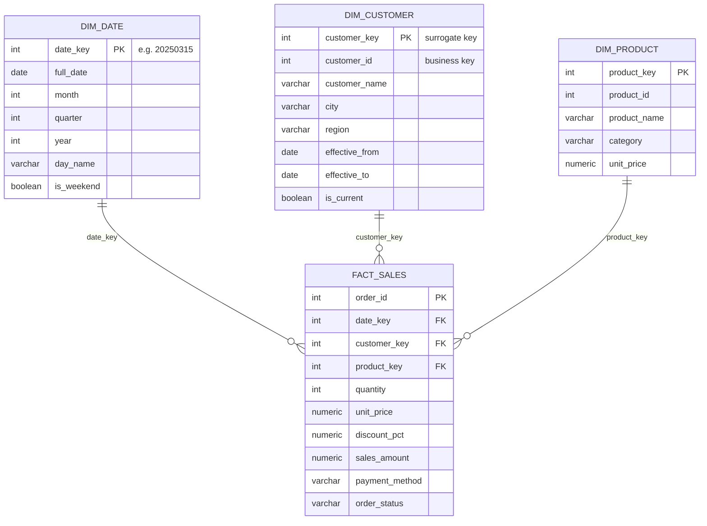

# Retail Sales Data Pipeline & Data Warehouse (SQL)

An end-to-end data engineering project that takes **messy raw sales data**, cleans it,
models it into a **star schema data warehouse**, tracks customer history with
**SCD Type 2**, processes new data with **incremental loads (MERGE)**, and runs the
whole pipeline with **one Python command**.

**Tech:** PostgreSQL · SQL · Python

---

## Project Overview

An online retail store sends three raw data files (customers, products, orders).
The data has real-world problems: duplicate rows, extra spaces, inconsistent
capitalisation, missing values and invalid quantities. Later, a **second batch**
arrives with new orders, changed order statuses, new customers, and customers
who moved to a different city.

This project:

1. **Loads** raw CSV files into a `raw` layer exactly as they arrive
2. **Profiles and cleans** the data into a `clean` layer with proper types and keys
3. **Tests** data quality with automated PASS/FAIL checks
4. **Models** the data as a **star schema** (`dw` layer) with fact and dimension tables
5. **Tracks history** of customer changes with **SCD Type 2**
6. **Loads new batches incrementally** with `MERGE` (insert new rows, update changed rows)
7. **Automates** everything with a Python pipeline runner with logging and restart support
8. **Analyses** the data with 26 business queries, including window functions

## Architecture

```
                                  ┌──────────────── first load ────────────────┐
 ┌──────────────┐   ┌───────────┐   ┌──────────────┐   ┌────────────────────────┐
 │ CSV files    │──►│ RAW       │──►│ CLEAN        │──►│ DW (star schema)       │
 │ customers    │   │ all TEXT, │   │ typed,       │   │ fact_sales             │
 │ products     │   │ as-is     │   │ deduped,     │   │ dim_customer (SCD2)    │
 │ orders       │   │           │   │ PK/FK, tests │   │ dim_product, dim_date  │
 └──────────────┘   └───────────┘   └──────────────┘   └────────────────────────┘
                                          ▲  MERGE                ▲  MERGE / SCD2
 ┌──────────────┐   ┌───────────┐         │                       │
 │ New batch    │──►│ STAGING   │─────────┴───────────────────────┘
 │ new orders   │   │           │      incremental load
 │ cust updates │   │           │
 └──────────────┘   └───────────┘

            run_pipeline.py runs all 9 steps in order, logs each one,
                  and stops at the first error or failed check
```

## Star Schema



## Project Structure

```
retail-sales-sql-project/
├── data/
│   ├── customers.csv              # first load
│   ├── products.csv
│   ├── orders.csv
│   ├── customer_updates.csv       # second batch: moved + new customers
│   └── new_orders.csv             # second batch: new orders + status changes
├── scripts/
│   └── generate_data.py           # creates the sample dataset
├── sql/
│   ├── 01_create_tables.sql       # raw, clean and staging schemas
│   ├── 02_load_raw_data.sql       # load CSVs into raw tables
│   ├── 03_data_cleaning.sql       # profiling + cleaning + transformation
│   ├── 04_data_quality_checks.sql # automated PASS/FAIL tests
│   ├── 05_business_analysis.sql   # 18 business questions + a view
│   ├── 06_star_schema.sql         # fact + dimension tables, initial load
│   ├── 07_scd_type2_customers.sql # customer history (SCD Type 2)
│   ├── 08_incremental_load.sql    # MERGE new/changed orders + warehouse checks
│   └── 09_warehouse_analysis.sql  # 8 queries on the star schema
├── run_pipeline.py                # runs the whole pipeline in one command
└── README.md
```

## Data Cleaning Summary

| Problem found                     | How it was fixed                          | Rows affected |
|-----------------------------------|-------------------------------------------|---------------|
| Duplicate customer rows           | `DISTINCT ON (customer_id)`               | 8             |
| Duplicate order rows              | `DISTINCT ON (order_id)`                  | 25            |
| Extra spaces / wrong case in names and cities | `TRIM()` + `INITCAP()`        | ~34% of customers |
| Missing emails                    | Empty strings converted to `NULL`         | 18            |
| Missing payment method            | Filled with `'Unknown'`                   | 91            |
| Zero or negative quantity         | Rows removed                              | 29            |

Result: **308 → 300 customers** and **3,025 → 2,971 orders**, with all 7 quality checks passing.

## SCD Type 2: Tracking Customer History

When a customer moves city, the old row is **closed** and a **new version** is added.
Old sales stay linked to the old city; new sales link to the new city.

| customer_key | customer_id | city    | effective_from | effective_to | is_current |
|--------------|-------------|---------|----------------|--------------|------------|
| 17           | 17          | Mumbai  | 1900-01-01     | 2025-12-31   | false      |
| 301          | 17          | Kolkata | 2026-01-01     | 9999-12-31   | true       |

In the second batch, **15 customers moved** and **10 new customers** joined, giving
**325 versions for 310 customers**. Query Q5 in `09_warehouse_analysis.sql` shows why this
matters: using only the current city would move about ₹85,000 of past revenue out of the West
region and into other regions, which would be wrong.

## Incremental Load

The second order batch (225 rows) contains **200 new orders**, **20 status changes**
(Delivered → Returned) and **5 duplicates**. A single `MERGE` inserts the new orders,
updates the changed ones and ignores the rest, in both the clean layer and the fact table.

The load is **idempotent**: running it again changes nothing, so a failed run can safely be retried.
After loading, 5 warehouse checks run, including fact-to-source row and revenue reconciliation
and checks that each customer has exactly one current version with no overlapping dates.

## Business Questions Answered

| Level | Questions | SQL concepts |
|-------|-----------|--------------|
| 1. Basics | Total revenue, revenue by year, order status split, payment methods | `GROUP BY`, aggregates, `CASE` |
| 2. Joins | Revenue by category, top products, revenue by region, top customers, customers who never ordered | `INNER JOIN`, `LEFT JOIN` |
| 3. CTEs | Products with above-average return rate, customer value segments | `WITH`, subqueries |
| 4. Window functions | Month-over-month growth, running totals, top 3 per category, moving average, repeat customer rate, latest order per customer | `LAG`, `RANK`, `ROW_NUMBER`, `SUM() OVER`, `PARTITION BY` |
| 5. Star schema | Revenue by quarter, weekday vs weekend, category by year, historical vs current region, new customers | fact-dimension joins, pivot with `CASE` |

## Key Insights

- **₹59.3 lakh** revenue from 2,402 delivered orders in 2024–2025, with an average order value of ₹2,468
- **Electronics drives 54% of revenue**, and the Smart Watch alone brings in over ₹10.8 lakh
- **About 19% of orders are cancelled or returned**, which is a clear area to investigate
- **Sunday** is the strongest sales day, and weekend orders have a slightly higher average value
- Revenue stayed **flat year over year** (2024 vs 2025), so growth is a concern

## How to Run

**1. Install PostgreSQL 15 or newer** (`MERGE` needs version 15+; pgAdmin is included in the installer)

**2. Create a database**
```bash
createdb retail_db
```

**3. Run the whole pipeline**
```bash
python run_pipeline.py
# with connection details:
python run_pipeline.py --db retail_db --user postgres --host localhost --port 5432
```

Other options:
```bash
python run_pipeline.py --from-step 7        # resume from a step after fixing an error
python run_pipeline.py --only-incremental   # re-run just the new-batch steps (7 and 8)
python run_pipeline.py --show-output        # print every query result
```

Logs are written to `logs/pipeline.log`. You can also run any SQL file by itself:
`psql -d retail_db -f sql/03_data_cleaning.sql`

*(Optional)* Regenerate the dataset with `python scripts/generate_data.py`.

## What I Learned

- Why data engineers keep **raw, clean and warehouse layers** and never modify source data
- How to **profile data** before cleaning it, instead of guessing
- Designing a **star schema** with **surrogate keys** and a **date dimension**
- **SCD Type 1 vs Type 2**, and how to keep history without losing past accuracy
- **Incremental loading** with `MERGE`, and why pipelines must be **idempotent**
- Writing **data quality and reconciliation checks** that stop a pipeline when data is wrong
- **Automating** a pipeline with logging and restart-from-step support

## Future Improvements

- Containerise with **Docker** so it runs anywhere with one command
- Schedule the pipeline with **Airflow**
- Move the transformations into **dbt** models with built-in tests
- Build a **Power BI / Tableau dashboard** on top of the star schema
